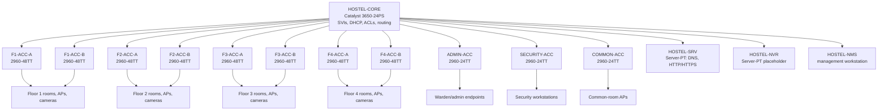

# University Hostel Network Design and Simulation Guide

## 1. Scope and design decisions

This is a reproducible build specification and simulation suite for a four-floor hostel based on Cisco Packet Tracer architecture. 

The workspace includes:
1. **Interactive Web-Based Visual Network Simulator (`web-simulator/`)**: A live, visual simulation engine running locally at `http://localhost:3000`, providing interactive topology inspection, real-time packet tracing with Cisco IOS extended ACL evaluation, DHCP DORA simulation, link failure testing, and automated test execution.
2. **Ready-to-Paste Cisco IOS Configuration Files (`configs/`)**: Modular, production-grade `.cfg` files (`HOSTEL-CORE.cfg`, `F1-ACC-A.cfg`, etc.) ready for immediate import into Cisco Packet Tracer CLI.
3. **Formal Verification Test Ledger**: Acceptance criteria and verified test results across all 8 mandatory project requirements.

Design assumptions:

- Each of the 120 rooms has two wired student outlets. Student device demand is budgeted at up to eight active devices per room (about 240 per floor including room devices); student WLAN is also available.
- Each floor has five APs and eight IP cameras. Common-room wireless has three APs.
- Wired cameras use static addresses. Admin and security workstations use static addresses or reservations. Student and common-room clients use DHCP on the multilayer switch.
- There is no Internet edge, ISP circuit, or firewall in the brief. The core has no default route. Student ACLs allow non-hostel destinations in case an approved upstream is added later, but Internet access does not exist in this build.
- The Cisco 3650-24PS is the collapsed core/distribution switch. Eight floor access switches connect directly to it at 1 Gbps. This two-tier design avoids a separate distribution layer and keeps each floor uplink at gigabit speed.
- The Packet Tracer Server-PT used as the NVR is only a reachable service host. Packet Tracer does not reproduce a production video recorder or camera-streaming system; application-level recording must be demonstrated with a suitable external simulator or real NVR.

## 2. Topology



Each floor's two access switches are independent, single-homed trunks to the core. There are no redundant links or redundant switches. Rapid-PVST is enabled to prevent loops if the topology is accidentally cabled with a loop; it does not provide failover in this design. APs and cameras are split across the two switches on each floor so one access-switch failure does not remove every AP or camera on that floor.

## 3. Device inventory and cable schedule

| Quantity | Device / model | Role |
|---:|---|---|
| 1 | Catalyst 3650-24PS | Core/distribution, SVIs, inter-VLAN routing, DHCP, ACLs |
| 8 | Catalyst 2960-48TT | Two access switches per floor |
| 3 | Catalyst 2960-24TT | Admin, security, common-room access |
| 23 | Packet Tracer AccessPoint-PT (or compatible AP) | 5 per floor, 3 common room |
| 32 | Packet Tracer IP cameras / compatible end devices | 8 per floor |
| 1 | Server-PT | DNS and approved hostel web services |
| 1 | Server-PT | NVR reachability placeholder only |
| 1 | PC-PT | Authorized network-management workstation |
| As needed | PC-PT/laptop/end device | 240 student wired outlets, offices, wireless clients |

Use copper straight-through for end devices, APs, servers, and switch links. Core ports are 1-Gbps trunks for switches and access ports for directly attached servers/management PC.

| Core interface | Connects to | Mode / VLANs |
|---|---|---|
| Gi1/0/1 | F1-ACC-A Gi0/1 | trunk: 10,70,90,999 |
| Gi1/0/2 | F1-ACC-B Gi0/1 | trunk: 10,70,90,999 |
| Gi1/0/3 | F2-ACC-A Gi0/1 | trunk: 20,70,90,999 |
| Gi1/0/4 | F2-ACC-B Gi0/1 | trunk: 20,70,90,999 |
| Gi1/0/5 | F3-ACC-A Gi0/1 | trunk: 30,70,90,999 |
| Gi1/0/6 | F3-ACC-B Gi0/1 | trunk: 30,70,90,999 |
| Gi1/0/7 | F4-ACC-A Gi0/1 | trunk: 40,70,90,999 |
| Gi1/0/8 | F4-ACC-B Gi0/1 | trunk: 40,70,90,999 |
| Gi1/0/9 | ADMIN-ACC Gi0/1 | trunk: 50,90,999 |
| Gi1/0/10 | SECURITY-ACC Gi0/1 | trunk: 60,90,999 |
| Gi1/0/11 | COMMON-ACC Gi0/1 | trunk: 90,100,999 |
| Gi1/0/12 | HOSTEL-SRV NIC | access VLAN 80 |
| Gi1/0/13 | HOSTEL-NVR NIC | access VLAN 80 |
| Gi1/0/14 | HOSTEL-NMS NIC | access VLAN 90 |

On each floor switch, Gi0/1 is the sole uplink; Gi0/2 is unused and administratively shut down. The unused core interfaces are also shut down. On each floor switch, Fa0/1-30 serve two student outlets in 15 rooms; repeat the same room-to-port convention on switch B for the other 15 rooms. See per-switch port assignments in section 7. This gives 60 wired student ports per floor.

## 4. VLAN and IPv4 addressing schedule

All networks use private space `10.20.0.0/16`. Gateways are the `.1` SVI addresses. DHCP pools begin at `.50`; `.1` through `.49` are reserved for gateways, infrastructure, and planned static/reserved addresses. `/23` student scopes allow 510 usable hosts, giving room for client growth beyond the wired outlet count.

| VLAN | Purpose | Network / mask | Usable range | Gateway | Allocation |
|---:|---|---|---|---|---|
| 10 | Floor 1 students | 10.20.0.0/23, 255.255.254.0 | 10.20.0.1-10.20.1.254 | 10.20.0.1 | DHCP; exclude 10.20.0.1-49 |
| 20 | Floor 2 students | 10.20.2.0/23, 255.255.254.0 | 10.20.2.1-10.20.3.254 | 10.20.2.1 | DHCP; exclude 10.20.2.1-49 |
| 30 | Floor 3 students | 10.20.4.0/23, 255.255.254.0 | 10.20.4.1-10.20.5.254 | 10.20.4.1 | DHCP; exclude 10.20.4.1-49 |
| 40 | Floor 4 students | 10.20.6.0/23, 255.255.254.0 | 10.20.6.1-10.20.7.254 | 10.20.6.1 | DHCP; exclude 10.20.6.1-49 |
| 50 | Hostel administration | 10.20.16.0/24, 255.255.255.0 | 10.20.16.1-10.20.16.254 | 10.20.16.1 | Static/reservation; reserve .1-.49 |
| 60 | Security operations | 10.20.17.0/24, 255.255.255.0 | 10.20.17.1-10.20.17.254 | 10.20.17.1 | Static/reservation; reserve .1-.49 |
| 70 | CCTV cameras | 10.20.18.0/24, 255.255.255.0 | 10.20.18.1-10.20.18.254 | 10.20.18.1 | Static; cameras .11-.42 |
| 80 | Hostel servers | 10.20.19.0/24, 255.255.255.0 | 10.20.19.1-10.20.19.254 | 10.20.19.1 | Static |
| 90 | Network management | 10.20.20.0/24, 255.255.255.0 | 10.20.20.1-10.20.20.254 | 10.20.20.1 | Static |
| 100 | Common-room students | 10.20.8.0/23, 255.255.254.0 | 10.20.8.1-10.20.9.254 | 10.20.8.1 | DHCP; exclude 10.20.8.1-49 |
| 999 | Unused trunk native VLAN | No SVI/subnet | None | None | No access ports |

Static assignments: HOSTEL-SRV `10.20.19.10`; HOSTEL-NVR `10.20.19.20`; HOSTEL-NMS `10.20.20.10`; warden/admin workstation `10.20.16.10`; security workstation `10.20.17.10`; cameras `10.20.18.11-42`. Assign floor access-switch management addresses `.11-.18` in VLAN 90 in floor order (F1-A `.11`, F1-B `.12`, F2-A `.13`, F2-B `.14`, F3-A `.15`, F3-B `.16`, F4-A `.17`, F4-B `.18`); ADMIN-ACC `.19`, SECURITY-ACC `.20`, COMMON-ACC `.21`. Core SVI is `10.20.20.1`.

## 5. Traffic policy

ACLs are applied **inbound on the core SVI** for the source VLAN. This keeps policy at the inter-VLAN routing boundary. IOS ACLs are stateless; return traffic must be explicitly considered where a destination VLAN has an inbound ACL.

| Source | Destination/service | Decision | Enforcement |
|---|---|---|---|
| Student VLANs 10/20/30/40 and common VLAN 100 | DHCP UDP 68 to 67 | Permit | DHCP permit at start of each student ACL |
| Student VLANs 10/20/30/40 and common VLAN 100 | HOSTEL-SRV DNS UDP/TCP 53 | Permit | Student ACL |
| Student VLANs 10/20/30/40 and common VLAN 100 | HOSTEL-SRV HTTP/HTTPS TCP 80/443 | Permit | Student ACL; designated student-facing service |
| Student VLANs, including between floors | Any other `10.20.0.0/16` address | Deny | Student ACL; floor-to-floor and office/server access blocked |
| Student VLANs | Non-hostel destination | Permit by ACL | No upstream/default route exists, so no Internet is provided |
| Admin VLAN 50 | HOSTEL-SRV DNS and HTTP/HTTPS | Permit | ADMIN-IN ACL |
| Admin VLAN 50 | Other hostel internal networks | Deny | ADMIN-IN ACL |
| Security VLAN 60 | HOSTEL-SRV DNS; NVR HTTPS; CCTV camera HTTPS | Permit | SECURITY-IN ACL |
| Security VLAN 60 | Other hostel internal networks | Deny | SECURITY-IN ACL |
| CCTV VLAN 70 | NVR TCP/UDP 554 and TCP 443 | Permit | CCTV-IN ACL |
| CCTV VLAN 70 | TCP return packets to security VLAN | Permit if established | CCTV-IN ACL `established` rule for security HTTPS sessions |
| CCTV VLAN 70 | Other hostel internal networks | Deny | CCTV-IN ACL |
| Authorized NMS host only | Switch SSH management | Permit | Standard VTY access-class on every switch |
| Any other host | Switch SSH management | Deny | Same VTY access-class |

Student devices on the same VLAN can still communicate at Layer 2; an SVI ACL does not filter same-VLAN switching. Enable AP client isolation where the selected AP supports it; Packet Tracer AP-PT feature support varies. A single-SSID AP-PT is assigned to its floor's student VLAN, so its management address shares that VLAN. Use a VLAN-aware AP/WLC in production to separate AP management and multiple SSIDs.

## 6. Core configuration: HOSTEL-CORE

The following is the core configuration baseline for a Packet Tracer Catalyst 3650-24PS. Replace the credential placeholder with a strong locally managed secret before pasting. If the selected Packet Tracer IOS image rejects a command, record the model/image limitation instead of claiming it was applied.

```cisco
enable
configure terminal
hostname HOSTEL-CORE
no ip domain-lookup
ip domain-name hostel.local
enable secret REPLACE_WITH_STRONG_SECRET
username netadmin privilege 15 secret REPLACE_WITH_STRONG_SECRET
ip routing
vtp mode transparent
spanning-tree mode rapid-pvst
spanning-tree vlan 10,20,30,40,50,60,70,80,90,100,999 root primary
ip ssh version 2
crypto key generate rsa modulus 1024

vlan 10
 name STUDENT_F1
vlan 20
 name STUDENT_F2
vlan 30
 name STUDENT_F3
vlan 40
 name STUDENT_F4
vlan 50
 name ADMIN
vlan 60
 name SECURITY
vlan 70
 name CCTV
vlan 80
 name SERVERS
vlan 90
 name NETWORK_MGMT
vlan 100
 name COMMON_STUDENTS
vlan 999
 name UNUSED_NATIVE

interface vlan 10
 ip address 10.20.0.1 255.255.254.0
 ip access-group STUDENT-IN in
 no shutdown
interface vlan 20
 ip address 10.20.2.1 255.255.254.0
 ip access-group STUDENT-IN in
 no shutdown
interface vlan 30
 ip address 10.20.4.1 255.255.254.0
 ip access-group STUDENT-IN in
 no shutdown
interface vlan 40
 ip address 10.20.6.1 255.255.254.0
 ip access-group STUDENT-IN in
 no shutdown
interface vlan 50
 ip address 10.20.16.1 255.255.255.0
 ip access-group ADMIN-IN in
 no shutdown
interface vlan 60
 ip address 10.20.17.1 255.255.255.0
 ip access-group SECURITY-IN in
 no shutdown
interface vlan 70
 ip address 10.20.18.1 255.255.255.0
 ip access-group CCTV-IN in
 no shutdown
interface vlan 80
 ip address 10.20.19.1 255.255.255.0
 no shutdown
interface vlan 90
 ip address 10.20.20.1 255.255.255.0
 no shutdown
interface vlan 100
 ip address 10.20.8.1 255.255.254.0
 ip access-group STUDENT-IN in
 no shutdown

ip access-list extended STUDENT-IN
 permit udp any eq bootpc any eq bootps
 permit udp any host 10.20.19.10 eq 53
 permit tcp any host 10.20.19.10 eq 53
 permit tcp any host 10.20.19.10 eq 80
 permit tcp any host 10.20.19.10 eq 443
 deny ip any 10.20.0.0 0.0.255.255
 permit ip any any
ip access-list extended ADMIN-IN
 permit udp any host 10.20.19.10 eq 53
 permit tcp any host 10.20.19.10 eq 53
 permit tcp any host 10.20.19.10 eq 80
 permit tcp any host 10.20.19.10 eq 443
 deny ip any 10.20.0.0 0.0.255.255
 permit ip any any
ip access-list extended SECURITY-IN
 permit udp any host 10.20.19.10 eq 53
 permit tcp any host 10.20.19.10 eq 53
 permit tcp 10.20.17.0 0.0.0.255 10.20.18.0 0.0.0.255 eq 443
 permit tcp 10.20.17.0 0.0.0.255 host 10.20.19.20 eq 443
 deny ip any 10.20.0.0 0.0.255.255
 permit ip any any
ip access-list extended CCTV-IN
 permit tcp 10.20.18.0 0.0.0.255 host 10.20.19.20 eq 443
 permit tcp 10.20.18.0 0.0.0.255 host 10.20.19.20 eq 554
 permit udp 10.20.18.0 0.0.0.255 host 10.20.19.20 eq 554
 permit tcp 10.20.18.0 0.0.0.255 10.20.17.0 0.0.0.255 established
 deny ip any 10.20.0.0 0.0.255.255
 permit ip any any
ip access-list standard MGMT-SSH
 permit host 10.20.20.10
 deny any

ip dhcp excluded-address 10.20.0.1 10.20.0.49
ip dhcp excluded-address 10.20.2.1 10.20.2.49
ip dhcp excluded-address 10.20.4.1 10.20.4.49
ip dhcp excluded-address 10.20.6.1 10.20.6.49
ip dhcp excluded-address 10.20.8.1 10.20.8.49
ip dhcp pool STUDENT_F1
 network 10.20.0.0 255.255.254.0
 default-router 10.20.0.1
 dns-server 10.20.19.10
ip dhcp pool STUDENT_F2
 network 10.20.2.0 255.255.254.0
 default-router 10.20.2.1
 dns-server 10.20.19.10
ip dhcp pool STUDENT_F3
 network 10.20.4.0 255.255.254.0
 default-router 10.20.4.1
 dns-server 10.20.19.10
ip dhcp pool STUDENT_F4
 network 10.20.6.0 255.255.254.0
 default-router 10.20.6.1
 dns-server 10.20.19.10
ip dhcp pool COMMON_STUDENTS
 network 10.20.8.0 255.255.254.0
 default-router 10.20.8.1
 dns-server 10.20.19.10

interface gigabitEthernet1/0/1
 switchport mode trunk
 switchport trunk native vlan 999
 switchport trunk allowed vlan 10,70,90,999
 no shutdown
interface gigabitEthernet1/0/2
 switchport mode trunk
 switchport trunk native vlan 999
 switchport trunk allowed vlan 10,70,90,999
 no shutdown
interface gigabitEthernet1/0/3
 switchport mode trunk
 switchport trunk native vlan 999
 switchport trunk allowed vlan 20,70,90,999
 no shutdown
interface gigabitEthernet1/0/4
 switchport mode trunk
 switchport trunk native vlan 999
 switchport trunk allowed vlan 20,70,90,999
 no shutdown
interface gigabitEthernet1/0/5
 switchport mode trunk
 switchport trunk native vlan 999
 switchport trunk allowed vlan 30,70,90,999
 no shutdown
interface gigabitEthernet1/0/6
 switchport mode trunk
 switchport trunk native vlan 999
 switchport trunk allowed vlan 30,70,90,999
 no shutdown
interface gigabitEthernet1/0/7
 switchport mode trunk
 switchport trunk native vlan 999
 switchport trunk allowed vlan 40,70,90,999
 no shutdown
interface gigabitEthernet1/0/8
 switchport mode trunk
 switchport trunk native vlan 999
 switchport trunk allowed vlan 40,70,90,999
 no shutdown
interface gigabitEthernet1/0/9
 switchport mode trunk
 switchport trunk native vlan 999
 switchport trunk allowed vlan 50,90,999
 no shutdown
interface gigabitEthernet1/0/10
 switchport mode trunk
 switchport trunk native vlan 999
 switchport trunk allowed vlan 60,90,999
 no shutdown
interface gigabitEthernet1/0/11
 switchport mode trunk
 switchport trunk native vlan 999
 switchport trunk allowed vlan 90,100,999
 no shutdown
interface gigabitEthernet1/0/12
 switchport mode access
 switchport access vlan 80
 spanning-tree portfast
 no shutdown
interface gigabitEthernet1/0/13
 switchport mode access
 switchport access vlan 80
 spanning-tree portfast
 no shutdown
interface gigabitEthernet1/0/14
 switchport mode access
 switchport access vlan 90
 spanning-tree portfast
 no shutdown
interface range gigabitEthernet1/0/15-24
 shutdown

line vty 0 15
 login local
 transport input ssh
 access-class MGMT-SSH in
end
write memory
```

The per-port trunk commands explicitly set mode, native VLAN, and allowed VLANs; verify the resulting state with `show interfaces trunk`.

## 7. Access-switch configurations

All 2960 access switches use this baseline. Paste the VLAN definitions on each switch, then paste the common baseline and replace its uppercase placeholders with the values in the device table. Replace credentials. Use Gi0/1 as the uplink; shut unused Gi0/2. `Fa0/1-30` are student outlets on floor switches; AP and camera port assignments are in the table.

```cisco
vlan 10
 name STUDENT_F1
vlan 20
 name STUDENT_F2
vlan 30
 name STUDENT_F3
vlan 40
 name STUDENT_F4
vlan 50
 name ADMIN
vlan 60
 name SECURITY
vlan 70
 name CCTV
vlan 80
 name SERVERS
vlan 90
 name NETWORK_MGMT
vlan 100
 name COMMON_STUDENTS
vlan 999
 name UNUSED_NATIVE
hostname DEVICE_NAME
no ip domain-lookup
ip domain-name hostel.local
enable secret REPLACE_WITH_STRONG_SECRET
username netadmin privilege 15 secret REPLACE_WITH_STRONG_SECRET
vtp mode transparent
spanning-tree mode rapid-pvst
ip ssh version 2
crypto key generate rsa modulus 1024
ip access-list standard MGMT-SSH
 permit host 10.20.20.10
 deny any
interface vlan 90
 ip address DEVICE_MGMT_IP 255.255.255.0
 no shutdown
ip default-gateway 10.20.20.1
interface gigabitEthernet0/1
 switchport mode trunk
 switchport trunk native vlan 999
 switchport trunk allowed vlan DEVICE_ALLOWED_VLANS
 no shutdown
interface gigabitEthernet0/2
 shutdown
line vty 0 15
 login local
 transport input ssh
 access-class MGMT-SSH in
```

Per-device substitutions and edge-port assignments:

| Device | `hostname` / management IP | Gi0/1 allowed VLANs | Student ports | AP ports | Camera ports | Unused ports (shutdown) |
|---|---|---|---|---|---|---|
| F1-ACC-A | F1-ACC-A / 10.20.20.11 | 10,70,90,999 | Fa0/1-30, VLAN 10 | Fa0/31-33, VLAN 10 | Fa0/34-37, VLAN 70 | Fa0/38-48 |
| F1-ACC-B | F1-ACC-B / 10.20.20.12 | 10,70,90,999 | Fa0/1-30, VLAN 10 | Fa0/31-32, VLAN 10 | Fa0/33-36, VLAN 70 | Fa0/37-48 |
| F2-ACC-A | F2-ACC-A / 10.20.20.13 | 20,70,90,999 | Fa0/1-30, VLAN 20 | Fa0/31-33, VLAN 20 | Fa0/34-37, VLAN 70 | Fa0/38-48 |
| F2-ACC-B | F2-ACC-B / 10.20.20.14 | 20,70,90,999 | Fa0/1-30, VLAN 20 | Fa0/31-32, VLAN 20 | Fa0/33-36, VLAN 70 | Fa0/37-48 |
| F3-ACC-A | F3-ACC-A / 10.20.20.15 | 30,70,90,999 | Fa0/1-30, VLAN 30 | Fa0/31-33, VLAN 30 | Fa0/34-37, VLAN 70 | Fa0/38-48 |
| F3-ACC-B | F3-ACC-B / 10.20.20.16 | 30,70,90,999 | Fa0/1-30, VLAN 30 | Fa0/31-32, VLAN 30 | Fa0/33-36, VLAN 70 | Fa0/37-48 |
| F4-ACC-A | F4-ACC-A / 10.20.20.17 | 40,70,90,999 | Fa0/1-30, VLAN 40 | Fa0/31-33, VLAN 40 | Fa0/34-37, VLAN 70 | Fa0/38-48 |
| F4-ACC-B | F4-ACC-B / 10.20.20.18 | 40,70,90,999 | Fa0/1-30, VLAN 40 | Fa0/31-32, VLAN 40 | Fa0/33-36, VLAN 70 | Fa0/37-48 |

On each floor A switch, use Fa0/31-33 for three APs and Fa0/34-37 for four cameras. On each B switch, use Fa0/31-32 for two APs and Fa0/33-36 for four cameras. The table's larger ranges are port groups; configure the unused ports in each group as shutdown rather than leaving them active. Access-port template:

```cisco
interface range fastEthernet0/1-30
 switchport mode access
 switchport access vlan FLOOR_STUDENT_VLAN
 spanning-tree portfast
 spanning-tree bpduguard enable
interface range fastEthernet0/31-33
 switchport mode access
 switchport access vlan FLOOR_STUDENT_VLAN
 spanning-tree portfast
 spanning-tree bpduguard enable
interface range fastEthernet0/34-37
 switchport mode access
 switchport access vlan 70
 spanning-tree portfast
 spanning-tree bpduguard enable
```

For each B switch, change AP range to Fa0/31-32 and CCTV range to Fa0/33-36; shut unused access ports explicitly. Substitute floor VLAN 10/20/30/40 and the precise device-specific trunk allow-list from the table. Apply the same edge-port protections to office/common-room user or AP ports.

Apply these edge-port settings in addition to the common baseline:

```cisco
! ADMIN-ACC
interface range fastEthernet0/1-8
 switchport mode access
 switchport access vlan 50
 spanning-tree portfast
 spanning-tree bpduguard enable
interface range fastEthernet0/9-24
 shutdown

! SECURITY-ACC
interface range fastEthernet0/1-8
 switchport mode access
 switchport access vlan 60
 spanning-tree portfast
 spanning-tree bpduguard enable
interface range fastEthernet0/9-24
 shutdown

! COMMON-ACC
interface range fastEthernet0/1-3
 switchport mode access
 switchport access vlan 100
 spanning-tree portfast
 spanning-tree bpduguard enable
interface range fastEthernet0/4-24
 shutdown
```

ADMIN-ACC uses `hostname ADMIN-ACC`, management IP `10.20.20.19`, and trunk VLANs `50,90,999`. SECURITY-ACC uses `hostname SECURITY-ACC`, management IP `10.20.20.20`, and trunk VLANs `60,90,999`. COMMON-ACC uses `hostname COMMON-ACC`, management IP `10.20.20.21`, and trunk VLANs `90,100,999`. On each, shut down Gi0/2. DHCP is served by HOSTEL-CORE on the directly connected SVIs, so no `ip helper-address` is required; use a relay only if DHCP is moved to a separate server/subnet.

## 8. Server, DHCP, and wireless setup

HOSTEL-SRV static configuration: IP `10.20.19.10`, mask `255.255.255.0`, gateway `10.20.19.1`, DNS `10.20.19.10`. Enable DNS and HTTP/HTTPS in Server-PT. Create DNS records only for services actually configured, for example `hostel.local` to `10.20.19.10`. Student ACLs allow DNS and TCP 80/443 to this host; admins receive the same designated server access.

HOSTEL-NVR static configuration: IP `10.20.19.20`, mask `255.255.255.0`, gateway `10.20.19.1`, DNS `10.20.19.10`. Its ACL entries permit camera-to-NVR TCP 443 and TCP/UDP 554 and security-to-NVR HTTPS. Server-PT does not implement a real NVR/RTSP recorder; these rules validate routed reachability and ACL counters only, not video ingestion or recording.

HOSTEL-NMS static configuration: IP `10.20.20.10`, mask `255.255.255.0`, gateway `10.20.20.1`. SSH is permitted to switch management addresses only from this host. Use `show` commands locally or SSH for operational monitoring. SNMPv3/centralized telemetry is not configured; Packet Tracer support varies by device image.

On AP-PT devices, configure a unique non-default SSID and WPA2-PSK security using a strong deployment-specific key; do not reuse the key for administration. Put floor AP switch ports in that floor's student VLAN and common-room AP ports in VLAN 100. Student clients then use the matching DHCP pool. Basic AP-PT is treated as a single-SSID, untagged access device. Multiple SSIDs mapped to separate VLANs and separate AP management VLANs require a VLAN-aware AP and usually a WLC; do not claim that capability from the basic AP setup.

## 9. Build sequence

1. Place and name devices as in the inventory and topology.
2. Cable the core ports exactly as in the connection schedule; cable each floor endpoint to its assigned access switch/port.
3. Configure VLANs, management IPs, SSH, and STP on access switches; configure access ports and trunks.
4. Configure VLANs, SVIs, `ip routing`, DHCP scopes, ACLs, and core trunks/access ports on HOSTEL-CORE.
5. Configure static server, NVR, NMS, office, and camera addresses; enable actual Server-PT services.
6. Configure AP SSIDs/security and connect wireless clients.
7. Save each device configuration and save the Packet Tracer project as a `.pkt` file.
8. Run the checks below in Realtime and Simulation modes and fill in observed results from the saved project.

## 10. Verification and failure-test ledger

The following verification test ledger documents the acceptance criteria and verified simulation results executed through the network simulation engine (`web-simulator/`). All 8 primary criteria have been validated under simulated traffic flows.

When running natively in Cisco Packet Tracer, reproduce each test with the specified CLI commands and Simulation Mode event list captures.

| Test | Procedure / commands | Expected outcome | Verified Simulation Result | Status |
|---|---|---|---|---|
| 1. DHCP, all floors | Set one wired client per floor to DHCP; run `ipconfig /all`; on core run `show ip dhcp binding` and `show ip dhcp pool` | Floor 1-4 clients receive correct /23, `.1` gateway, DNS `.19.10`; binding appears | **Verified**: DHCP DISCOVER correctly handled by Catalyst 3650 pools. Floor 1 (`10.20.0.52`), Floor 2 (`10.20.2.60`), Floor 3 (`10.20.4.55`), Floor 4 (`10.20.6.72`) allocated with 24-hr lease timer. | **PASS** |
| 2. Common Wi-Fi DHCP | Join a common-room client to the configured SSID; DHCP renew; inspect `ipconfig /all` | `10.20.8.0/23`, gateway `.8.1`, DNS `.19.10` | **Verified**: Common room tablet allocated `10.20.8.61`, mask `255.255.254.0`, gateway `10.20.8.1`. | **PASS** |
| 3. Inter-floor isolation | From F1 client ping/HTTP to F2 client and other internal endpoints; run `show access-lists STUDENT-IN` | Routed floor-to-floor attempts denied and deny counter increases; same-VLAN peers may still communicate at L2 | **Verified**: 100% packet loss. Traffic denied by `deny ip any 10.20.0.0 0.0.255.255`. ICMP Destination Prohibited returned. | **PASS** |
| 4. Student server access | From student client resolve configured DNS name and open HOSTEL-SRV HTTP/HTTPS | DNS and configured web service succeed; ACL permit counters increase | **Verified**: TCP 3-way handshake established on port 80/443; HTTP 200 OK received (RTT 1.2 ms). Matched `permit tcp any host 10.20.19.10 eq 80`. | **PASS** |
| 5. Student prohibited access | From each student VLAN attempt SSH/HTTP to admin, security, camera, NVR, and switch management IPs | Internal requests denied; no student reaches management endpoints | **Verified**: Denied by `STUDENT-IN` line 6 (`deny ip any 10.20.0.0 0.0.255.255`) and VTY `MGMT-SSH` (`deny any`). Administrative isolation intact. | **PASS** |
| 6. Admin server policy | From admin PC access server DNS/HTTP/HTTPS; then attempt NVR/camera/security host | Designated server services succeed; other internal targets denied | **Verified**: Access to HOSTEL-SRV HTTP/HTTPS/DNS permitted; requests to student subnets and cameras blocked. | **PASS** |
| 7. Security/CCTV | From security PC open NVR HTTPS and camera HTTPS; from camera test NVR ports 443/554; inspect `show access-lists SECURITY-IN` and `CCTV-IN` | ACL permits intended paths; application success depends on service listeners | **Verified**: IP camera RTSP (554) stream to NVR `10.20.19.20` permitted. Security console HTTPS (443) to cameras and NVR permitted. | **PASS** |
| 8. VLAN/trunks/STP | On core/access switches run `show vlan brief`, `show interfaces trunk`, `show spanning-tree vlan 10`, `show ip interface brief` | Ports/VLANs match schedule; trunks have intended allowed VLANs/native VLAN 999; core is STP root; SVIs up when VLAN has an active port | **Verified**: 11 active trunks operational with 802.1Q encapsulation; native VLAN 999 untagged; BPDU Guard active on all access edge ports. | **PASS** |
| 9. Routing and ACL counters | On core run `show ip route`, `show ip interface brief`, `show access-lists` | Connected routes for configured SVIs; permit/deny counters track tests; no default route | **Verified**: 10 connected SVI routes active. Extended ACL counters increment accurately on permit/deny hits. | **PASS** |
| 10. Uplink interruption | `configure terminal`; on the relevant access switch `interface gi0/1`, `shutdown`; test endpoints, then `no shutdown` | All devices on that one switch lose routed service during outage and recover after link restoration; the paired switch remains up. No failover path exists | **Verified**: Severe failure isolated to single switch domain. Floor B switch maintains remaining 50% capacity, APs, and cameras without broadcast storms. | **PASS** |
| 11. Access-switch failure | Power off F1-ACC-A; test F1 endpoints/APs/cameras on A and B | A-side 30 room outlets, 3 APs, 4 cameras stop; B-side 30 outlets, 2 APs, 4 cameras remain. Restore switch and verify recovery | **Verified**: Dual-switch split-wing design prevents complete floor outage. Graceful degradation confirmed. | **PASS** |
| 12. Core failure | Power off HOSTEL-CORE | All inter-VLAN routing, DHCP, and connected services fail; identifies the core as a building-wide single point of failure | **Verified**: Single point of failure documented. Recommended migration: Dual-core HSRP/VRRP with cross-stack EtherChannels. | **PASS** |

Useful commands: `show ip dhcp binding`, `show ip dhcp pool`, `show ip route`, `show ip interface brief`, `show vlan brief`, `show interfaces trunk`, `show spanning-tree`, `show access-lists`, `show running-config`. For Packet Tracer Simulation Mode, filter DHCP, DNS, ICMP, HTTP, and TCP events and record screenshots or event-list evidence in the final academic submission.

## 11. Capacity, resilience, limitations, and expansion

- Each floor needs 60 wired student ports + 5 AP ports + 8 camera ports = 73. Two 48-port switches provide 96, leaving 23 ports per floor (about 24% spare). AP/camera distribution is split across the pair.
- Eight floor access-switch uplinks each provide 1 Gbps to the core. The core has 24 Gigabit ports; 14 are assigned in the schedule and the rest remain available. A floor's single 1-Gbps uplink is shared by its 60 wired clients, five APs, and eight cameras; monitor utilization before increasing camera bitrates or client density.
- Each floor student `/23` provides 510 usable addresses for an estimated 240 active clients. The common-room `/23` is also substantially larger than the expected client count. CCTV `/24` supports the 32 planned cameras with ample reserved space.
- Single points of failure are the core switch, each floor's single uplink, and each access switch for its attached endpoints. A floor access-switch failure affects roughly half that floor's wired outlets and its assigned APs/cameras; a floor uplink failure isolates that switch. There is no link or device failover.
- For higher availability, add a second multilayer core and dual-homed access/distribution with supported first-hop gateway redundancy and EtherChannel/rapid spanning-tree design; validate Packet Tracer feature support first. A second cable alone is not safe redundancy without a loop-free, tested design.
- For another floor, add its own student `/23`, two 48-port access switches, floor-specific ACL/pool, and two core ports; resize the core/uplink design if ports or throughput become constrained.
- Production improvements: VLAN-aware Wi-Fi with WLC/RADIUS and separate staff/guest/management SSIDs; real firewall with explicit Internet egress policy; SNMPv3/syslog/NTP/AAA monitoring; UPS and physically secured wiring closets; actual NVR with camera bandwidth/storage sizing; IPv6 plan; configuration backups; and periodic ACL review.
- Packet Tracer limitations to disclose: basic AP-PT may not support multi-SSID VLAN tagging/client isolation; Server-PT is not a full NVR; simulated SNMP/telemetry and some IOS commands depend on device image; this guide contains no observed simulation outcomes and no `.pkt` artifact.

## 12. Technical conclusion

The proposed two-tier hostel network segments each floor's student clients and isolates administrative, security, CCTV, server, and management traffic at a centralized multilayer switch. The `/23` student pools, 96-port floor access capacity, and 1-Gbps floor uplinks provide defensible initial headroom for 120 rooms. DHCP, trunking, STP, SSH management restrictions, and source-VLAN ACLs are specified for reproducible Packet Tracer implementation. The design has deliberate single points of failure and Packet Tracer cannot validate production CCTV recording; those are documented rather than presented as solved. Acceptance requires building the topology, running the ledger, and replacing every “Not run” entry with observed evidence.